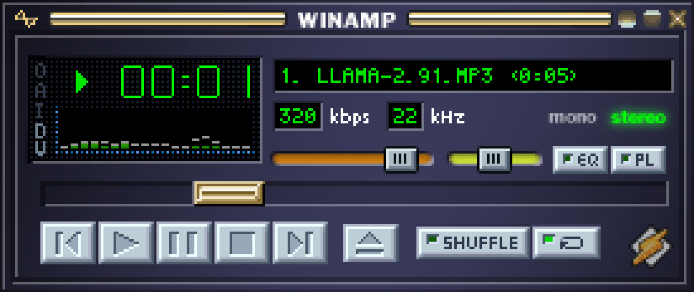

# NisseAMP 🦙⚡

An authentic **Winamp 2.x** clone written in **Perl** and rendered with **OpenGL**.



NisseAMP faithfully recreates the classic Winamp 2.91 main window, complete with pixel-perfect classic skin rendering, the iconic green LCD display, real-time 19-band spectrum analyzer with falling peak hold dots, oscilloscope mode, audio playback engine, interactive sliders, windowshade mode, and drag-and-drop audio playback.

---

## ✨ Features

- **Pixel-Perfect Winamp 2.x Visuals**:
  - Authentic Winamp 2.91 classic skin textures (`MAIN`, `TITLEBAR`, `CBUTTONS`, `NUMBERS`, `TEXT`, `PLAYPAUS`, `MONOSTER`, `SHUFREP`, `VOLUME`, `BALANCE`, `POSBAR`).
  - Nearest-neighbor texture filtering preserves sharp retro pixel art at any resolution.
  - Floating frameless window that can be freely dragged anywhere on your desktop by the titlebar or metal frame.

- **Interactive Green LCD Screen**:
  - **Large LED Time Display**: Minutes and seconds in classic Winamp digit font. Clicking the time digits toggles between **Time Elapsed** and **Time Remaining** (with minus indicator). Digits blink when playback is paused.
  - **19-Band Spectrum Analyzer**: Logarithmically spaced frequency bands computed via real-time discrete Fourier transform of the audio stream. Uses authentic colors 2–17 from `VISCOLOR.TXT` with falling peak hold dots (color 23).
  - **Oscilloscope Mode**: Real-time waveform oscilloscope trace across the visualizer box. Clicking the visualizer cycles between **Spectrum Analyzer → Oscilloscope → Off**.
  - **Scrolling Song Title Marquee**: Classic 5×6 bitmap font smoothly scrolling long titles. Displays temporary status notifications when adjusting volume, balance, or seek position (e.g. `VOLUME: 85%`, `BALANCE: 20% LEFT`, `SEEK TO: 01:23 / 03:45 (37%)`).
  - **Bitrate & Sample Rate**: Displays kbps (e.g. `320`) and kHz (e.g. `44`), plus bright green stereo / mono indicator LEDs.

- **Audio Engine**:
  - Integrated audio engine powered by [`miniaudio`](https://github.com/mackron/miniaudio) with native macOS CoreAudio backend.
  - Supports **MP3**, **WAV**, and **FLAC** audio playback.
  - Includes the legendary bundled intro track (*"Winamp, it really whips the llama's ass!"*).
  - **Built-in Procedural Retro Chiptune Synthesizer**: A 4-channel retro demoscene tracker engine (lead arpeggios, bass, pulse waves, and noise drums) that can be triggered anytime with key `L` or the Eject button.
  - **Drag & Drop**: Drag any MP3, WAV, or FLAC audio file from macOS Finder directly onto the NisseAMP window to immediately load, decode, and play it!

- **Windowshade Mode ('W')**:
  - Collapses the 116px window into a compact 14px windowshade bar with mini transport controls, mini seeker bar, and mini visualizer.


- **Flexible Window Scaling ('D')**:
  - Supports **1x** (275×116), **2x** (550×232 default), **3x** (825×348), and **4x** (1100×464) crisp pixel scaling.
  - Press `D` or keys `1`, `2`, `3`, `4` to switch scale on the fly.

---

## ⌨️ Controls & Shortcuts

| Key / Action | Function |
| :--- | :--- |
| **Mouse Drag Window** | Click and drag titlebar or metal frame to move window |
| **Mouse Drag Sliders** | Drag Volume, Balance, or Seek sliders |
| **Mouse Scroll Wheel** | Adjust volume up / down |
| **Click Time Digits** | Toggle Elapsed vs Remaining time |
| **Click Visualizer** | Cycle Spectrum Analyzer ↔ Oscilloscope ↔ Off |
| **Drag & Drop File** | Drop MP3, WAV, or FLAC onto window to play immediately |
| **Z** | Previous track / Seek to start |
| **X** | Play |
| **C** | Pause / Resume |
| **V** | Stop |
| **B** | Next track |
| **L** / **Eject (^)** | Start procedural retro chiptune synthesizer |
| **S** | Toggle Shuffle |
| **R** | Toggle Repeat |
| **D** | Toggle 2x / 3x double size |
| **W** | Toggle Windowshade mode |
| **1, 2, 3, 4** | Set scale factor (1x, 2x, 3x, 4x) |
| **Up / Down Arrow** | Volume +5% / -5% |
| **Left / Right Arrow** | Seek backward / forward 5 seconds |
| **Space** | Play / Pause toggle |
| **Esc** | Exit |

---

## 🚀 Running NisseAMP

### Prerequisites
- Perl 5 (standard system Perl on macOS)
- Homebrew GLFW (`brew install glfw`)
- Clang (standard Apple Developer Tools)

### Quick Start
```bash
# Run with default settings (2x scale, demo track)
perl nisseamp.pl

# Play a specific audio file
perl nisseamp.pl /path/to/favorite_song.mp3

# Run with 3x scale
perl nisseamp.pl --scale 3

# Run with standard OS window border
perl nisseamp.pl --border

# Start directly in retro chiptune synthesizer mode
perl nisseamp.pl --synth
```

---

## 📁 Project Structure

```
NisseAMP/
├── nisseamp.pl           # Executable application entry point
├── Makefile              # Build automation for C core
├── README.md             # Documentation & screenshots
├── lib/
│   ├── NisseAMP.pm       # Main application lifecycle manager
│   └── NisseAMP/
│       ├── Core.pm       # Perl Inline::C wrapper to native core
│       ├── Player.pm     # Playlist, playback state & track manager
│       └── Skin.pm       # Classic Winamp skin manager
├── src/
│   ├── nisseamp_core.h   # C core API declarations
│   ├── nisseamp_core.c   # GLFW, OpenGL 2D renderer, miniaudio & FFT
│   ├── miniaudio.h       # Single-header audio playback engine
│   └── stb_image.h       # Single-header image loader
├── assets/
│   ├── audio/            # Bundled demo audio (llama-2.91.mp3)
│   └── skin/             # Winamp 2.91 classic skin assets (PNG/BMP)
└── screenshots/          # High-resolution screenshots
```

---

*“NisseAMP — It really whips the llama's ass!”* 🦙
